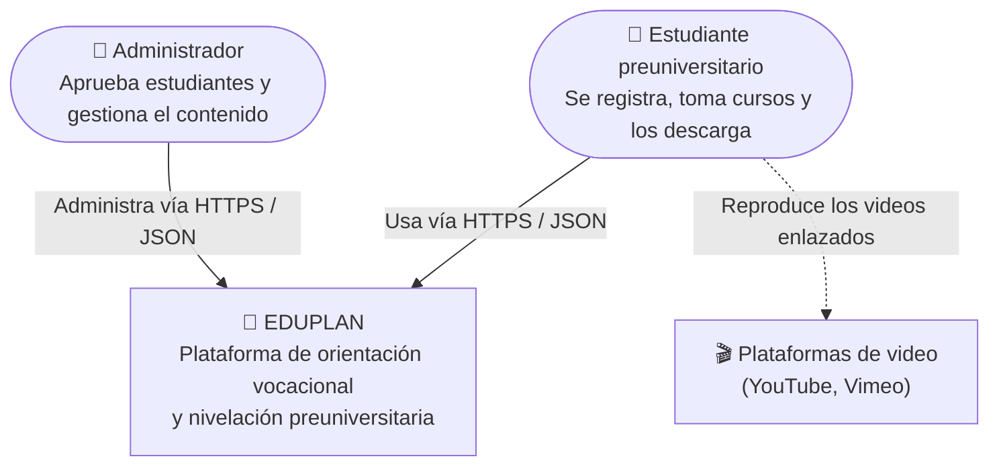
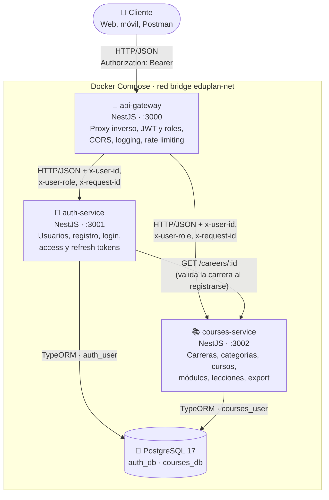
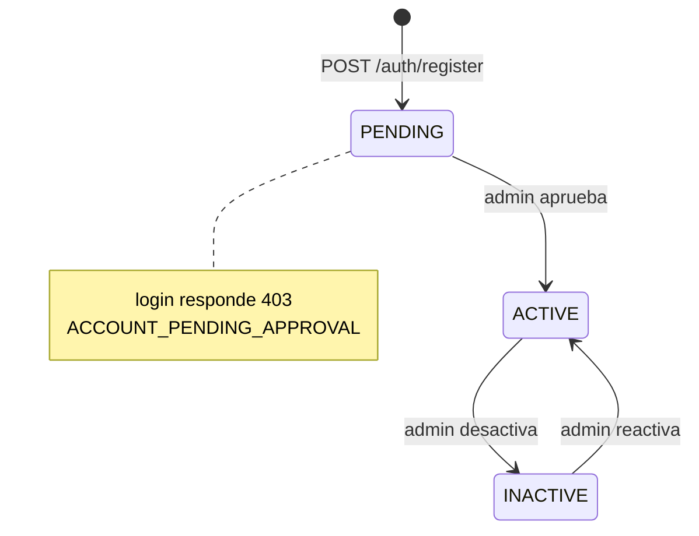
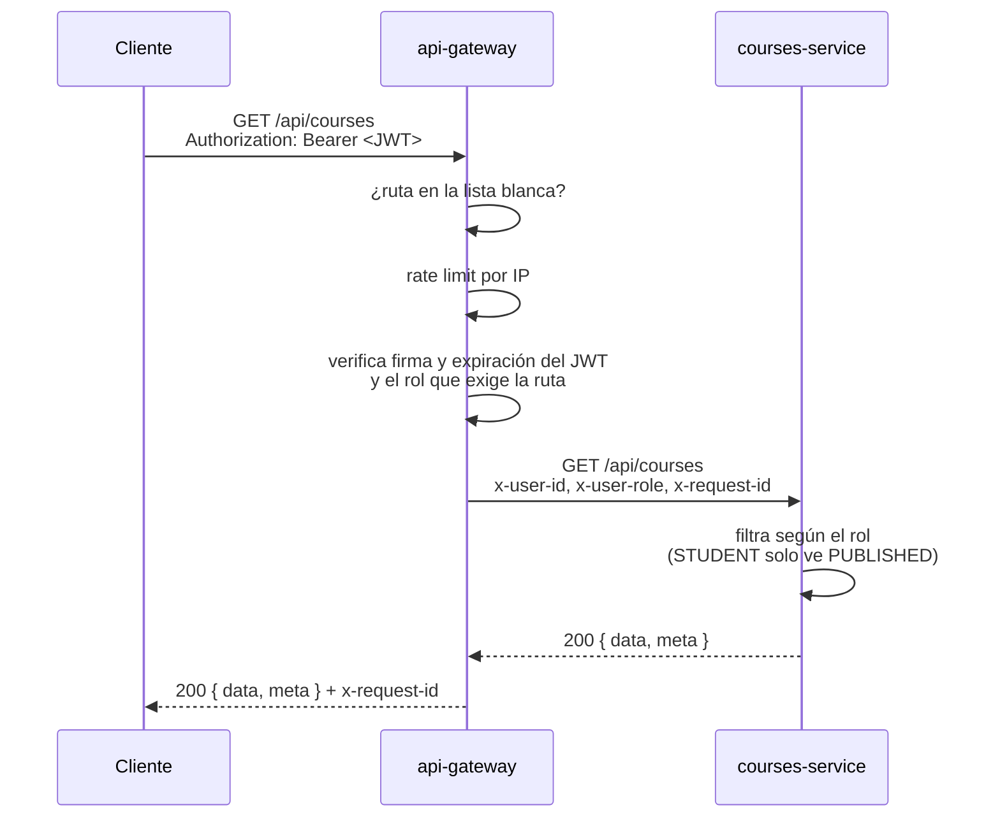

# EDUPLAN · Backend

Plataforma de **orientación vocacional y cursos de nivelación preuniversitaria** construida con una
arquitectura de microservicios en **NestJS**: un API Gateway como único punto de entrada, un
servicio de identidad y un servicio de catálogo académico, cada uno con su propia base de datos
PostgreSQL, orquestados con Docker Compose.

---

## Índice

1. [Descripción del dominio](#1-descripción-del-dominio)
2. [Arquitectura (C4)](#2-arquitectura-c4)
3. [Stack tecnológico](#3-stack-tecnológico)
4. [Estructura del repositorio](#4-estructura-del-repositorio)
5. [Puesta en marcha con Docker](#5-puesta-en-marcha-con-docker)
6. [Desarrollo local sin Docker](#6-desarrollo-local-sin-docker)
7. [Variables de entorno](#7-variables-de-entorno)
8. [Autenticación y autorización](#8-autenticación-y-autorización)
9. [Endpoints](#9-endpoints)
10. [Formato de errores](#10-formato-de-errores)
11. [Pruebas con Postman](#11-pruebas-con-postman)
12. [Pruebas con cURL](#12-pruebas-con-curl)
13. [Patrones y decisiones de diseño](#13-patrones-y-decisiones-de-diseño)
14. [Estrategia Git Flow](#14-estrategia-git-flow)
15. [Solución de problemas](#15-solución-de-problemas)
16. [Trabajo futuro](#16-trabajo-futuro)

---

## 1. Descripción del dominio

Muchos jóvenes de zonas rurales —el piloto está pensado para colegios de los **Yungas de La Paz,
Bolivia**— terminan el colegio sin una orientación clara sobre qué estudiar, con poca información
sobre carreras y con una preparación académica que los deja en desventaja frente a postulantes de la
ciudad. Además, la conectividad es limitada.

EDUPLAN aborda ese problema con:

- **Orientación vocacional**: un curso corto que ayuda al estudiante a identificar una carrera de
  interés, apoyado en un **catálogo de carreras**.
- **Cursos de nivelación** por área (Matemática para ingeniería, Biología para ciencias de la salud,
  Lenguaje…), organizados en **categorías**, con **módulos** y **lecciones** de texto o video.
- **Descarga sin conexión**: cada curso publicado puede exportarse completo en un único JSON para
  consumirlo offline.
- **Control de acceso**: los estudiantes se registran y quedan pendientes hasta que un
  administrador los aprueba.

### Entidades del dominio

| Servicio | Entidad | Descripción |
|---|---|---|
| auth-service | `User` | Estudiante o administrador; estado `PENDING`, `ACTIVE` o `INACTIVE` |
| auth-service | `RefreshToken` | Sesión del usuario (hash del token, expiración, revocación, rotación) |
| courses-service | `Career` | Carrera universitaria del catálogo (carrera de interés del estudiante) |
| courses-service | `Category` | Área de nivelación (Matemáticas, Biología…) |
| courses-service | `Course` | Curso de una categoría; estado `DRAFT` o `PUBLISHED` |
| courses-service | `CourseModule` | Módulo de un curso |
| courses-service | `Lesson` | Lección de un módulo, de tipo `TEXT` (markdown) o `VIDEO` (URL) |

---

## 2. Arquitectura (C4)

### Nivel 1 · Contexto



### Nivel 2 · Contenedores



- **Una base de datos por servicio**: un único contenedor PostgreSQL con dos bases y dos usuarios;
  cada usuario solo puede conectarse a su propia base (`REVOKE ALL ... FROM PUBLIC`).
- **Solo el gateway se expone a la red**. Los servicios y PostgreSQL se publican únicamente en
  `127.0.0.1` para depuración (Swagger, cliente SQL).

---

## 3. Stack tecnológico

| Capa | Tecnología |
|---|---|
| Lenguaje / framework | TypeScript 6 (ESM) · NestJS 12 · Node.js 24 |
| Persistencia | PostgreSQL 17 · TypeORM 1.x con migraciones |
| Seguridad | `@nestjs/jwt` (HS256) · bcrypt · refresh tokens opacos con rotación |
| Gateway | `http-proxy-middleware` · `@nestjs/throttler` · `path-to-regexp` |
| Validación | `class-validator` · `class-transformer` · Joi (variables de entorno) |
| Documentación | Swagger (`@nestjs/swagger`) · colección Postman |
| Observabilidad | `@nestjs/terminus` (health checks) · logs con `x-request-id` |
| Contenedores | Docker (imágenes multi-stage `node:24-alpine`) · Docker Compose v2 |
| Calidad | oxlint · Prettier |

---

## 4. Estructura del repositorio

```
eduplan-backend/
├── api-gateway/              # Punto único de entrada (sin base de datos)
│   └── src/
│       ├── common/middleware/    # request-id, logging, resolución de ruta
│       ├── config/               # validación de entorno y CORS
│       ├── modules/
│       │   ├── routing/          # lista blanca de rutas y políticas de acceso
│       │   ├── access/           # guard JWT + roles
│       │   ├── rate-limit/       # throttler global y de credenciales
│       │   └── proxy/            # reenvío a los servicios
│       └── app/health/           # health agregado
├── auth-service/
│   └── src/
│       ├── modules/users/        # entidad, repositorio, CRUD admin y perfil
│       ├── modules/auth/         # login, refresh, logout, tokens
│       ├── integrations/courses/ # cliente HTTP hacia courses-service
│       └── database/             # módulo TypeORM, migraciones y seed
├── courses-service/
│   └── src/
│       ├── modules/              # careers, categories, courses, course-modules, lessons
│       └── database/             # módulo TypeORM y migraciones
├── infra/postgres/           # script que crea una base y un usuario por servicio
├── postman/                  # colección y environment de Postman
├── docker-compose.yml
└── .env.example
```

Cada servicio de dominio sigue la misma organización por capas:

```
modules/<recurso>/
├── controllers/   # HTTP: rutas, códigos de estado, Swagger
├── services/      # reglas de negocio
├── repositories/  # acceso a datos (envuelve el Repository de TypeORM)
├── entities/      # mapeo a tablas
├── dto/           # contratos de entrada (validados) y de salida (fromEntity)
└── exceptions/    # errores de dominio con código propio
```

---

## 5. Puesta en marcha con Docker

**Requisitos:** Docker Desktop (o Docker Engine + Compose v2) y Git. No hace falta instalar Node.js
ni PostgreSQL.

```bash
git clone <URL-del-repositorio> eduplan-backend
cd eduplan-backend
```

```bash
docker compose up -d --build
```

Docker construye las imágenes, crea la red y arranca los contenedores en orden gracias a
`depends_on` + `healthcheck`: **postgres → courses-service → auth-service → api-gateway**. Cada
servicio aplica sus migraciones al arrancar.

Crear el administrador inicial (idempotente):

```bash
docker compose exec auth-service npm run seed:prod
```

Verificar que todo está sano:

```bash
docker compose ps
```

```bash
curl http://localhost:3000/api/health
```

| Recurso | URL | Accesible desde |
|---|---|---|
| **API Gateway** | http://localhost:3000/api | la red |
| Swagger de auth-service | http://localhost:3001/api/docs | solo esta máquina |
| Swagger de courses-service | http://localhost:3002/api/docs | solo esta máquina |
| PostgreSQL | `localhost:5433` (usuario `postgres` / `postgres`) | solo esta máquina |

Credenciales del administrador por defecto: `admin@eduplan.bo` / `Admin12345`.

Comandos útiles:

```bash
docker compose logs -f api-gateway
```

```bash
docker compose down
```

```bash
docker compose down -v
```

El último comando además **borra los datos** (volumen de PostgreSQL).

---

## 6. Desarrollo local sin Docker

Solo la base de datos corre en Docker; los servicios se ejecutan con Node.js 24 en modo watch.

```bash
cp .env.example .env
docker compose up -d postgres
```

En tres terminales, una por servicio (`courses-service`, `auth-service`, `api-gateway`):

```bash
cp .env.example .env
npm install
npm run start:dev
```

Crear el administrador (desde `auth-service`):

```bash
npm run seed
```

Scripts disponibles en cada servicio con base de datos:

| Script | Uso |
|---|---|
| `npm run start:dev` | Servidor en modo watch |
| `npm run build` | Compila a `dist/` |
| `npm run lint` | Linter (oxlint) |
| `npm run migration:generate -- src/database/migrations/Nombre` | Genera una migración comparando entidades y BD |
| `npm run migration:run` / `migration:revert` | Aplica / revierte migraciones |
| `npm run seed` / `seed:prod` | Crea el admin (solo auth-service; `seed:prod` usa el código compilado) |

> Si el stack de Docker está corriendo, detén el contenedor del servicio que quieras ejecutar
> localmente (`docker compose stop api-gateway`) para liberar su puerto.

---

## 7. Variables de entorno

`docker-compose.yml` define valores por defecto para todo, así que **no es obligatorio crear un
`.env`**. Para cambiarlos, copia `.env.example` a `.env` en la raíz.

| Variable | Por defecto | Usada por | Descripción |
|---|---|---|---|
| `NODE_ENV` | `development` | servicios | `production` desactiva Swagger y los logs de BD |
| `POSTGRES_USER` / `POSTGRES_PASSWORD` | `postgres` / `postgres` | postgres | Superusuario del motor |
| `POSTGRES_PORT` | `5433` | postgres | Puerto en el host |
| `AUTH_DB_NAME` / `AUTH_DB_USER` / `AUTH_DB_PASSWORD` | `auth_db` / `auth_user` / `auth_password` | postgres, auth | Base y usuario de auth-service |
| `COURSES_DB_NAME` / `COURSES_DB_USER` / `COURSES_DB_PASSWORD` | `courses_db` / `courses_user` / `courses_password` | postgres, courses | Base y usuario de courses-service |
| `JWT_ACCESS_SECRET` | secreto de desarrollo | auth, gateway | Firma HS256 de los access tokens (mín. 32 caracteres; **debe ser igual en ambos**) |
| `JWT_ACCESS_EXPIRES_IN` | `15m` | auth | Vida del access token |
| `REFRESH_TOKEN_TTL_DAYS` | `7` | auth | Vida del refresh token |
| `BCRYPT_ROUNDS` | `12` | auth | Costo de bcrypt |
| `CORS_ORIGINS` | `http://localhost:5173,http://localhost:4200` | gateway | Orígenes permitidos (`*` para todos) |
| `THROTTLE_LIMIT` | `100` | gateway | Peticiones por minuto por IP |
| `THROTTLE_AUTH_LIMIT` | `10` | gateway | Intentos por minuto en login y registro |
| `SEED_ADMIN_*` | `admin@eduplan.bo` / `Admin12345`… | auth (seed) | Datos del administrador inicial |

Cada servicio tiene además su propio `.env.example` para el desarrollo local. Las variables se
validan con Joi al arrancar: si falta una obligatoria, el servicio no inicia e indica cuál.

> ⚠️ Cambia `JWT_ACCESS_SECRET` y `SEED_ADMIN_PASSWORD` en cualquier entorno que no sea tu máquina.

---

## 8. Autenticación y autorización

### Ciclo de vida de una cuenta



### Tokens

| | Access token | Refresh token |
|---|---|---|
| Formato | JWT HS256 `{ sub, email, role }` | 48 bytes aleatorios (base64url) |
| Vida | 15 minutos | 7 días |
| Persistencia | No se guarda | Solo su hash SHA-256 en `refresh_tokens` |
| Lo verifica | api-gateway | auth-service |

- **Rotación**: cada `POST /auth/refresh` invalida el refresh token usado y entrega uno nuevo,
  dentro de una transacción.
- **Detección de reuso**: si llega un refresh token que ya fue rotado, se asume robo y se revocan
  todas las sesiones del usuario (`401 REFRESH_TOKEN_REUSED`).
- **Logout** revoca solo esa sesión; las de otros dispositivos siguen activas.

### Flujo de una petición autenticada



El gateway **descarta** cualquier `x-user-id` / `x-user-role` enviado por el cliente y los
reemplaza por los del token verificado, por lo que no es posible suplantar un rol.

### Matriz de acceso

| Recurso | Público | Estudiante (`STUDENT`) | Administrador (`ADMIN`) |
|---|---|---|---|
| `/auth/register`, `/auth/login`, `/auth/refresh`, `/auth/logout` | ✅ | ✅ | ✅ |
| `GET /careers`, `GET /careers/:id` | ✅ | ✅ | ✅ |
| Escritura de carreras | ❌ | ❌ | ✅ |
| `/users/me` (ver, editar, cambiar contraseña) | ❌ | ✅ | ✅ |
| Gestión de usuarios (`/users`) | ❌ | ❌ | ✅ |
| Lectura de categorías, cursos, módulos y lecciones | ❌ | ✅ solo cursos `PUBLISHED` | ✅ incluye `DRAFT` |
| Exportar curso | ❌ | ✅ solo `PUBLISHED` | ✅ |
| Escritura de categorías, cursos, módulos y lecciones; publicar | ❌ | ❌ | ✅ |
| `GET /health` | ✅ | ✅ | ✅ |

Las carreras son públicas porque el formulario de registro necesita listarlas antes de que el
estudiante tenga una cuenta.

---

## 9. Endpoints

Todas las rutas se consumen a través del gateway: **`http://localhost:3000/api`**. La especificación
detallada de cada endpoint (cuerpos, respuestas y errores posibles) está en el Swagger de cada
servicio.

Leyenda de acceso: 🌐 público · 🔑 autenticado · 🛡️ solo ADMIN.

### Auth y usuarios (auth-service)

| Método | Ruta | Acceso | Descripción |
|---|---|---|---|
| POST | `/auth/register` | 🌐 | Registro de estudiante (queda `PENDING`) |
| POST | `/auth/login` | 🌐 | Inicio de sesión → access + refresh token |
| POST | `/auth/refresh` | 🌐 | Rotación de tokens |
| POST | `/auth/logout` | 🌐 | Revoca el refresh token |
| GET | `/users/me` | 🔑 | Mi perfil |
| PATCH | `/users/me` | 🔑 | Editar nombre, teléfono, colegio o carrera |
| PATCH | `/users/me/password` | 🔑 | Cambiar mi contraseña |
| GET | `/users?page&limit&search&status&role` | 🛡️ | Listar usuarios |
| GET | `/users/:id` | 🛡️ | Obtener usuario |
| POST | `/users` | 🛡️ | Crear usuario (cualquier rol) |
| PATCH | `/users/:id` | 🛡️ | Editar datos, rol o contraseña |
| PATCH | `/users/:id/status` | 🛡️ | Aprobar, desactivar o dejar pendiente |
| DELETE | `/users/:id` | 🛡️ | Borrado lógico |

### Catálogo y contenido (courses-service)

| Método | Ruta | Acceso | Descripción |
|---|---|---|---|
| GET | `/careers?page&limit&search` | 🌐 | Listar carreras |
| GET | `/careers/:id` | 🌐 | Obtener carrera |
| POST · PATCH · DELETE | `/careers`, `/careers/:id` | 🛡️ | CRUD de carreras |
| GET | `/categories?page&limit&search` | 🔑 | Listar categorías |
| GET | `/categories/:id` | 🔑 | Obtener categoría |
| POST · PATCH · DELETE | `/categories`, `/categories/:id` | 🛡️ | CRUD de categorías |
| GET | `/courses?page&limit&search&categoryId&status` | 🔑 | Listar cursos |
| GET | `/courses/:id` | 🔑 | Detalle con módulos y lecciones |
| GET | `/courses/:id/export` | 🔑 | Curso completo para uso sin conexión |
| POST | `/courses` | 🛡️ | Crear curso (inicia en `DRAFT`) |
| PATCH | `/courses/:id` | 🛡️ | Editar curso |
| PATCH | `/courses/:id/status` | 🛡️ | Publicar / despublicar |
| DELETE | `/courses/:id` | 🛡️ | Borrado lógico en cascada |
| GET | `/modules?courseId` | 🔑 | Módulos de un curso |
| GET | `/modules/:id` | 🔑 | Obtener módulo |
| POST · PATCH · DELETE | `/modules`, `/modules/:id` | 🛡️ | CRUD de módulos |
| GET | `/lessons?moduleId` | 🔑 | Lecciones de un módulo |
| GET | `/lessons/:id` | 🔑 | Obtener lección |
| POST · PATCH · DELETE | `/lessons`, `/lessons/:id` | 🛡️ | CRUD de lecciones |

### Ejemplos de cuerpos JSON

**Registro** — `POST /auth/register`

```json
{
  "firstName": "María",
  "lastName": "Quispe Mamani",
  "email": "maria.quispe@gmail.com",
  "password": "Nivelate2026",
  "phone": "+591 71234567",
  "school": "U.E. Coroico",
  "careerId": "0b6f1c2e-6a0f-4a64-9b0e-2f6d7f2c1a11"
}
```

**Login** — `POST /auth/login` → `200`

```json
{
  "accessToken": "eyJhbGciOiJIUzI1NiIsInR5cCI6IkpXVCJ9...",
  "refreshToken": "kq3J9w...",
  "tokenType": "Bearer",
  "expiresIn": 900,
  "user": {
    "id": "8d0a0524-ff3c-4198-b19c-7bbf1518465a",
    "firstName": "María",
    "lastName": "Quispe Mamani",
    "email": "maria.quispe@gmail.com",
    "phone": "+591 71234567",
    "school": "U.E. Coroico",
    "careerId": "0b6f1c2e-6a0f-4a64-9b0e-2f6d7f2c1a11",
    "role": "STUDENT",
    "status": "ACTIVE",
    "lastLoginAt": null,
    "createdAt": "2026-10-18T21:09:57.479Z",
    "updatedAt": "2026-10-18T21:12:03.120Z"
  }
}
```

**Curso** — `POST /courses`

```json
{
  "title": "Matemática para ingeniería",
  "description": "Nivelación en álgebra, trigonometría y funciones.",
  "coverImageUrl": "https://cdn.eduplan.bo/covers/matematica.jpg",
  "estimatedHours": 40,
  "categoryId": "3d6b1917-e710-479f-b897-7512182dfd12"
}
```

**Lección de texto / de video** — `POST /lessons`

```json
{ "moduleId": "fd0a946e-...", "title": "Productos notables", "type": "TEXT", "content": "(a + b)² = a² + 2ab + b²" }
```

```json
{ "moduleId": "fd0a946e-...", "title": "Factorización", "type": "VIDEO", "videoUrl": "https://www.youtube.com/watch?v=abc123" }
```

**Listados paginados** → `200`

```json
{
  "data": [ { "id": "...", "title": "Matemática para ingeniería", "status": "PUBLISHED", "category": { "id": "...", "name": "Matemáticas" } } ],
  "meta": { "page": 1, "limit": 10, "total": 1, "pages": 1 }
}
```

**Detalle de curso** — `GET /courses/:id` → curso + `modules[]`, cada uno con `lessons[]`.

**Export** — `GET /courses/:id/export` → `{ "schemaVersion": 1, "exportedAt": "...", "course": { ...detalle } }`

---

## 10. Formato de errores

Los tres servicios responden los errores con el mismo formato:

```json
{
  "statusCode": 404,
  "error": "COURSE_NOT_FOUND",
  "message": "Course 76e35590-57f5-4ba7-831d-f06fc1a23e58 was not found.",
  "path": "/api/courses/76e35590-57f5-4ba7-831d-f06fc1a23e58",
  "timestamp": "2026-10-18T23:48:12.004Z"
}
```

`error` es un código estable en `SCREAMING_SNAKE_CASE` pensado para que el cliente decida qué
mostrar; `message` es un texto descriptivo (o un arreglo con los errores de validación).

| Código | HTTP | Origen | Significado |
|---|---|---|---|
| `BAD_REQUEST` | 400 | todos | Cuerpo o parámetros inválidos |
| `ROUTE_NOT_FOUND` | 404 | gateway | La ruta o el método no existen |
| `MISSING_TOKEN` / `INVALID_TOKEN` / `TOKEN_EXPIRED` | 401 | gateway | Problemas con el access token |
| `INSUFFICIENT_ROLE` | 403 | gateway | El rol no tiene permiso |
| `TOO_MANY_REQUESTS` | 429 | gateway | Límite de peticiones superado |
| `UPSTREAM_UNAVAILABLE` / `UPSTREAM_TIMEOUT` | 502 / 504 | gateway | El servicio de destino no responde |
| `INVALID_CREDENTIALS` | 401 | auth | Email o contraseña incorrectos |
| `ACCOUNT_PENDING_APPROVAL` / `ACCOUNT_INACTIVE` | 403 | auth | La cuenta no puede iniciar sesión |
| `INVALID_REFRESH_TOKEN` / `REFRESH_TOKEN_REUSED` | 401 | auth | Refresh token inválido, expirado o reutilizado |
| `EMAIL_ALREADY_EXISTS` | 409 | auth | Email ya registrado |
| `INVALID_CAREER_ID` | 400 | auth | La carrera no existe en el catálogo |
| `CANNOT_MODIFY_OWN_ACCOUNT` | 422 | auth | Un admin no puede cambiar su rol, estado o borrarse |
| `COURSES_SERVICE_UNAVAILABLE` | 503 | auth | No se pudo validar la carrera |
| `*_NOT_FOUND` | 404 | courses, auth | `CATEGORY`, `CAREER`, `COURSE`, `MODULE`, `LESSON`, `USER` |
| `*_ALREADY_EXISTS` | 409 | courses | Nombre o título duplicado |
| `INVALID_CATEGORY_ID` / `INVALID_COURSE_ID` / `INVALID_MODULE_ID` | 400 | courses | La referencia no existe |
| `CATEGORY_HAS_COURSES` | 409 | courses | No se puede borrar una categoría con cursos |
| `COURSE_NOT_PUBLISHABLE` | 422 | courses | El curso necesita al menos una lección |
| `INVALID_LESSON_CONTENT` | 400 | courses | TEXT requiere `content`; VIDEO requiere `videoUrl` |

---

## 11. Pruebas con Postman

La carpeta [`postman/`](postman) contiene:

- `EDUPLAN.postman_collection.json` — **59 peticiones en 13 carpetas** con tests automáticos.
- `EDUPLAN.local.postman_environment.json` — `baseUrl` y credenciales del administrador.

Pasos:

1. Levanta el stack y ejecuta el seed (sección 5).
2. En Postman: **Import** → selecciona los dos archivos.
3. Elige el environment **EDUPLAN · Local** (esquina superior derecha).
4. Abre la colección → **Run** → **Run EDUPLAN API**.

La colección recorre el flujo completo y guarda automáticamente tokens e ids en variables:

| Carpeta | Qué demuestra |
|---|---|
| 00 · Salud | Health agregado del gateway |
| 01 · Login del administrador | Obtención de tokens |
| 02 · Carreras | Catálogo público + CRUD de admin |
| 03 · Registro y aprobación | Registro `PENDING`, bloqueo de login, aprobación |
| 04 · Mi perfil | Identidad propagada por el gateway, cambio de contraseña |
| 05–08 · Categorías, cursos, módulos, lecciones | CRUD completo y reglas de negocio |
| 09 · Publicar y consumir | Publicación, árbol del curso, export offline |
| 10 · Tokens | Rotación, detección de reuso y logout |
| 11 · Seguridad del gateway | 401, 403, anti-suplantación, lista blanca, `x-request-id` |
| 12 · Limpieza | Borrado lógico en cascada y reglas de integridad |

Cada ejecución usa nombres únicos (`runId`) y limpia lo que crea, así que puede repetirse.

> **Rate limiting:** la colección hace 59 peticiones y el gateway permite 100 por minuto por IP.
> Si la ejecutas dos veces seguidas verás respuestas `429 TOO_MANY_REQUESTS`: es el limitador
> funcionando. Espera un minuto entre ejecuciones o sube `THROTTLE_LIMIT` en el `.env`.

También puede ejecutarse desde la terminal con Newman:

```bash
npx newman run postman/EDUPLAN.postman_collection.json -e postman/EDUPLAN.local.postman_environment.json
```

---

## 12. Pruebas con cURL

Ejemplos para **bash** (Linux, macOS o Git Bash en Windows). Con el stack levantado y el seed
ejecutado:

**1. Login del administrador y extracción del token**

```bash
ADMIN_TOKEN=$(curl -s -X POST http://localhost:3000/api/auth/login \
  -H "Content-Type: application/json" \
  -d '{"email":"admin@eduplan.bo","password":"Admin12345"}' \
  | sed -E 's/.*"accessToken":"([^"]+)".*/\1/')
```

**2. Crear una categoría**

```bash
curl -s -X POST http://localhost:3000/api/categories \
  -H "Authorization: Bearer $ADMIN_TOKEN" \
  -H "Content-Type: application/json" \
  -d '{"name":"Biologia","description":"Celula, genetica y anatomia"}'
```

**3. Listar categorías con paginación**

```bash
curl -s "http://localhost:3000/api/categories?page=1&limit=5" \
  -H "Authorization: Bearer $ADMIN_TOKEN"
```

**4. Registrar un estudiante (público)**

```bash
curl -s -X POST http://localhost:3000/api/auth/register \
  -H "Content-Type: application/json" \
  -d '{"firstName":"Luis","lastName":"Choque","email":"luis@example.com","password":"Nivelate2026","phone":"+591 72222222","school":"U.E. Irupana"}'
```

**5. Listar estudiantes pendientes de aprobación**

```bash
curl -s "http://localhost:3000/api/users?status=PENDING" \
  -H "Authorization: Bearer $ADMIN_TOKEN"
```

**6. Comprobar que una ruta protegida exige token**

```bash
curl -s -i http://localhost:3000/api/courses
```

**7. Seguir una petición en los logs con `x-request-id`**

```bash
curl -s -H "x-request-id: demo-trace-0001" http://localhost:3000/api/careers
```

```bash
docker compose logs api-gateway | grep demo-trace-0001
```

> En Git Bash para Windows, `curl` no envía UTF-8 para los caracteres acentuados escritos en la
> terminal; por eso los ejemplos usan texto sin tildes. Postman y Swagger no tienen ese problema.

---

## 13. Patrones y decisiones de diseño

| Patrón / decisión | Dónde | Por qué |
|---|---|---|
| **API Gateway** con lista blanca | `api-gateway/src/modules/routing/route-table.ts` | Único punto de entrada; nada se expone por accidente |
| **Repository** | `*/repositories/*.repository.ts` | El servicio no conoce TypeORM ni SQL |
| **DTO** de entrada y salida | `*/dto/` | Validación declarativa y control exacto de lo que sale (nunca el hash de la contraseña) |
| **Inyección de dependencias** | módulos de NestJS | Desacoplamiento y composición de capas |
| **Database per service** | `infra/postgres/init-databases.sh` | Cada servicio es dueño de sus datos |
| **Soft delete** | `BaseEntity.deletedAt` | Recuperabilidad; índices únicos parciales (`WHERE deleted_at IS NULL`) |
| **Migraciones** | `*/src/database/migrations` | Esquema versionado; se aplican al arrancar |
| **Excepciones de dominio** | `*/exceptions/` + filtro global | Errores uniformes con códigos estables |
| **Configuración validada** | `config/env.validation.ts` (Joi) | Falla rápido si falta una variable |
| **Propagación de identidad** | gateway → `x-user-id` / `x-user-role` | Los servicios no repiten la validación del JWT |
| **Degradación parcial** | `auth-service/src/integrations/courses` | Si courses-service cae, solo falla el registro con carrera |
| **Imágenes multi-stage sin root** | `*/Dockerfile` | Imágenes más pequeñas y seguras |

---

## 14. Estrategia Git Flow

| Rama | Propósito |
|---|---|
| `main` | Versiones entregables, etiquetadas (`v1.0.0`) |
| `develop` | Integración de las funcionalidades terminadas |
| `feature/*` | Una rama por fase del desarrollo, integrada en `develop` con `--no-ff` |
| `release/*` | Preparación de una versión antes de pasar a `main` |

Fases del desarrollo (cada una es una rama `feature/*`):

1. `feature/infra-setup` — PostgreSQL con una base por servicio
2. `feature/courses-categories-careers` — courses-service: categorías y carreras
3. `feature/courses-content` — cursos, módulos, lecciones, árbol y export
4. `feature/auth-service` — usuarios, bcrypt, JWT, refresh tokens y seed
5. `feature/api-gateway` — proxy, JWT y roles, CORS, logging, rate limiting
6. `feature/docker` — Dockerfiles y docker-compose
7. `feature/docs` — colección Postman y documentación
8. `release/1.0.0` — versión 1.0.0 en `main`

Los mensajes de commit siguen [Conventional Commits](https://www.conventionalcommits.org/)
(`feat:`, `fix:`, `docs:`, `build:`, `chore:`).

```bash
git log --oneline --graph --all
```

---

## 15. Solución de problemas

| Síntoma | Causa probable | Solución |
|---|---|---|
| `port is already allocated` al levantar | Otro proceso usa 3000–3002 o 5433 | Detén ese proceso o cambia `POSTGRES_PORT` |
| `401 INVALID_CREDENTIALS` con el admin | No se ejecutó el seed | `docker compose exec auth-service npm run seed:prod` |
| `401 INVALID_TOKEN` con un token recién emitido | `JWT_ACCESS_SECRET` distinto en auth y gateway | Usa el mismo valor en ambos |
| `401 TOKEN_EXPIRED` | El access token dura 15 minutos | `POST /auth/refresh` o vuelve a iniciar sesión |
| `429 TOO_MANY_REQUESTS` | Límite del gateway superado | Espera un minuto o ajusta `THROTTLE_*` |
| `502 UPSTREAM_UNAVAILABLE` | Un servicio está caído | `docker compose ps` y `docker compose logs <servicio>` |
| Las bases no se crean al cambiar credenciales | El script de init solo corre con el volumen vacío | `docker compose down -v` y vuelve a levantar |
| Acentos mal guardados desde cURL en Windows | Git Bash no envía UTF-8 | Usa Postman, Swagger o texto sin tildes |

---

## 16. Trabajo futuro

- Evaluaciones por módulo y por curso, generadas con IA para que cada intento sea distinto.
- Tests vocacionales y de personalidad dentro del curso de orientación.
- Registro de universidades, sedes y becas por carrera, con un mapa de dónde estudiar cada una.
- Seguimiento del progreso del estudiante y cursos con prerrequisitos.
- Aplicación cliente (web/móvil) con almacenamiento offline usando el endpoint de export.
- Rate limiting distribuido (Redis) para escalar el gateway a varias réplicas.
